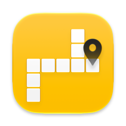
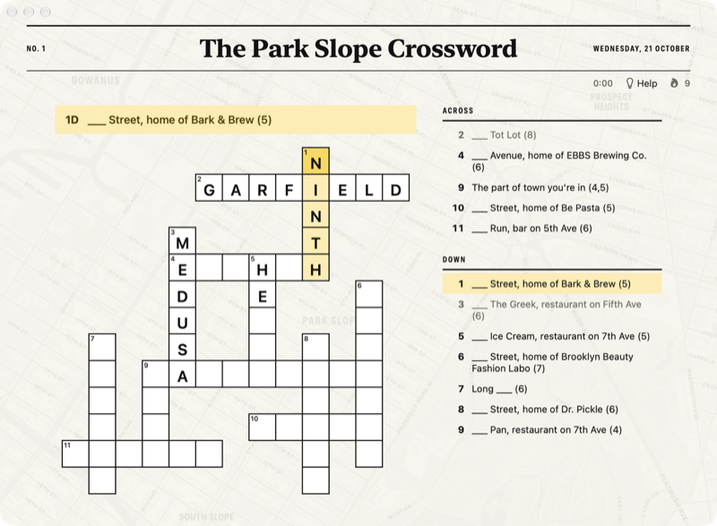

<p align="center"></p>

<h1 align="center">Local Crossings</h1>

<p align="center">A new crossword every morning, made from the streets, parks and corner spots around you.</p>

<p align="center"><a href="https://lamp.dev/?repo=https://github.com/lampdotdev/localcrossings&amp;from=readme"></a></p>

<p align="center"><a href="#build-it-yourself">Build it yourself</a></p>

<p align="center"></p>

## Make Local Crossings yours

Each opens Lamp with a copy of Local Crossings and that change, ready to send:

- [Give it a vintage atlas look](https://lamp.dev/?repo=https://github.com/lampdotdev/localcrossings&from=readme&ask=Give%20it%20a%20vintage%20atlas%20look)
- [Pin each answer on the map](https://lamp.dev/?repo=https://github.com/lampdotdev/localcrossings&from=readme&ask=Pin%20each%20answer%20on%20the%20map)
- [Make it about my favorite city](https://lamp.dev/?repo=https://github.com/lampdotdev/localcrossings&from=readme&ask=Make%20it%20about%20my%20favorite%20city)

## Open it in Lamp

[Lamp](https://lamp.dev) is a Mac app that builds apps from a description and changes them as you ask. [Open Local Crossings in Lamp](https://lamp.dev/?repo=https://github.com/lampdotdev/localcrossings&from=readme) for a copy of your own, to use and to change as you like, with the credits below kept. Or, in Lamp, choose File → Open from GitHub… and paste `https://github.com/lampdotdev/localcrossings`.

## Build it yourself

With Apple's Command Line Tools installed (`xcode-select --install`):

```bash
./build.sh
```

The AI inside the app, and anything it does with other apps or devices, goes through Lamp, so those need Lamp open on the same Mac.

## License

MIT. See [LICENSE](LICENSE).
